# Enterprise CRM – System Architecture Document

## 1. Executive Summary & Architectural Vision

> **Implementation Progress:**
> - **Phase 1 (Foundation):** Complete ✅
> - **Phase 2 (Database, Authentication & RBAC):** Complete ✅ (37 Tables in Supabase, PBKDF2 Hashing, JWT + Refresh Token Rotation, 5 System Roles, 38 Permissions, Full Org Management, React 19 Login & Protected Routes).
> - **Test Suite:** 21 Automated Tests Passing (11 Unit Tests + 10 Integration Tests against live Supabase PostgreSQL).

The Enterprise CRM is a robust, modular, multi-tenant-ready Web Application designed specifically for modern service-oriented enterprises (consulting, digital agencies, professional services, B2B technology providers). The platform centralizes end-to-end customer lifecycles—from omnichannel Lead acquisition and automated distribution, to Deal pipeline management, CPQ (Configure, Price, Quote), contract lifecycle and e-signing, project/milestone tracking, invoice issuance and debt collection, sales commission and payroll calculation, and an AI-powered executive co-pilot.

The architecture adheres strictly to **Clean Architecture (Domain-Driven Design principles)** on the Backend (.NET 10 Web API) and **Feature-Sliced / Modular Frontend Architecture** on the client (React 19 + TypeScript + Vite + Tailwind CSS + TanStack Query + Zustand).

---

## 2. System Architecture Overview

```mermaid
graph TD
    subgraph Client["Frontend Application (React 19 + TypeScript + Vite)"]
        UI["Design System (shadcn/ui + Tailwind CSS)"]
        State["Client State (Zustand) & Server Cache (TanStack Query)"]
        Routing["React Router v7 (Protected Routes + RBAC)"]
        Forms["React Hook Form + Zod Validation"]
        AxiosClient["Axios HTTP Client (JWT Interceptor + Retry)"]
    end

    subgraph API_Gateway["ASP.NET Core 10 Web API Layer"]
        CORS["CORS & Security Headers Middleware"]
        RateLimit["Rate Limiting & Anti-DDoS Middleware"]
        AuthMiddleware["JWT Authentication & Claims Principal Factory"]
        RBAC["Policy-Based Authorization & Scope Handlers"]
        ExceptionMiddleware["Global Exception Handler (RFC 7807 ProblemDetails)"]
        Controllers["RESTful API Controllers (Versioned)"]
        SignalRHub["SignalR Real-Time Hub (Notifications, Status)"]
    end

    subgraph App_Layer["EnterpriseCRM.Application (CQRS / Business Services)"]
        AppInterfaces["Service Interfaces & Repositories"]
        UseCases["Use Cases & Command/Query Handlers"]
        Validators["FluentValidation Pipeline"]
        DTOs["Request / Response DTOs & Mappings"]
    end

    subgraph Domain_Layer["EnterpriseCRM.Domain (Core Business Rules)"]
        Entities["Domain Entities (UUID Primary Keys, Auditable)"]
        ValueObjects["Value Objects & Smart Enums"]
        DomainEvents["Domain Events"]
        BusinessRules["Domain Invariants & Business Logic"]
    end

    subgraph Infra_Layer["EnterpriseCRM.Infrastructure"]
        EFCore["Entity Framework Core 10 (Npgsql Provider)"]
        HangfireEngine["Hangfire Background Job Engine"]
        SerilogSink["Serilog Structured Logging Engine"]
        StorageAdapter["Supabase Storage / S3 Document Client"]
        AIAdapter["AI Orchestrator (Gemini / OpenAI Adapter)"]
        ExternalIntegrations["Integration Adapters (E-Invoice, E-Sign, Webhooks)"]
    end

    subgraph Persistence["Storage & Database Layer"]
        Postgres[("Supabase PostgreSQL (SSL Required, Row-Level Security, Encrypted)")]
        FileStore[("Supabase Storage Buckets (Contracts, Attachments)")]
    end

    Client -->|HTTPS / WSS| API_Gateway
    API_Gateway --> App_Layer
    App_Layer --> Domain_Layer
    App_Layer --> Infra_Layer
    Infra_Layer --> Domain_Layer
    Infra_Layer --> Persistence
```



---

## 3. Technology Stack & Key Decisions

| Tier | Technology | Justification |
| :--- | :--- | :--- |
| **Frontend Framework** | React 19 + TypeScript 5.8 | Modern component paradigm, strict type safety, zero runtime type crashes. |
| **Build & Bundler** | Vite 6 | Sub-second HMR, optimized tree-shaking, fast ESM builds. |
| **Styling & Design System** | Tailwind CSS v3 + shadcn/ui + Radix UI primitives | Professional Enterprise Blue theme, high density, accessible, consistent UI tokens. |
| **Server State Management** | TanStack Query v5 | Automatic background refetching, query invalidation, caching, optimistic mutations. |
| **Client State Management** | Zustand | Lightweight, zero-boilerplate store for global layout, user sessions, preferences. |
| **Drag & Drop** | `@dnd-kit/core` & `@dnd-kit/sortable` | Performant, accessible Kanban board for Deals and Pipelines. |
| **Visualizations & Charts** | Recharts | Composable SVG-based chart library for revenue analytics and conversion funnels. |
| **Backend Framework** | ASP.NET Core Web API (.NET 10) | World-class throughput, robust type system, async I/O, enterprise security. |
| **ORM & Data Access** | Entity Framework Core 10 with Npgsql | Production-grade PostgreSQL integration, connection pooling, compiled queries. |
| **Background Processing** | Hangfire | Persistent background job processing with SQL storage, dashboard, retries, cron jobs. |
| **Real-time Push** | SignalR Core | WebSockets fallback to SSE for notifications, lead arrival, approval updates. |
| **Database** | Supabase PostgreSQL | Fully managed PostgreSQL with SSL Mode=Require, ACID compliance, robust indexing. |

---

## 4. Backend Clean Architecture Layers

### 4.1 EnterpriseCRM.Domain
- Pure C# project with **zero external dependencies**.
- Defines core entities: `User`, `Employee`, `Department`, `Team`, `Lead`, `Account`, `Contact`, `Deal`, `Quotation`, `Contract`, `Project`, `Payment`, `Invoice`, `CommissionPolicy`, `Payroll`, etc.
- Base constructs: `BaseEntity<Guid>`, `IAuditableEntity`, `ISoftDeletable`.
- Enums: `LeadStatus`, `DealStage`, `ContractStatus`, `InvoiceStatus`, `PaymentMethod`, `CommissionType`.

### 4.2 EnterpriseCRM.Application
- Orchestrates business workflows and use cases.
- Implements request validation using `FluentValidation`.
- Defines interfaces: `IApplicationDbContext`, `ICurrentUserService`, `IIdentityService`, `INotificationService`, `ILeadAssignmentEngine`, `ICommissionCalculator`, `IAiAssistantService`.
- Standardized response wrappers: `ApiResponse<T>`, `PaginatedList<T>`.

### 4.3 EnterpriseCRM.Infrastructure
- Implements interfaces defined in the Application layer.
- `ApplicationDbContext` inherits `DbContext`, manages configurations using Fluent API (`IEntityTypeConfiguration<T>`).
- PostgreSQL configuration: SSL enforcement, UTC timestamp converters, UUID generation, index definitions.
- Adapters for external services: Mock and live adapters for E-Invoices (MISA, VNPT, Viettel), E-Signatures, and AI APIs.
- Serilog integration for structured JSON logs.

### 4.4 EnterpriseCRM.API
- Entry point: `Program.cs`.
- REST controllers organized by business capability (`/api/v1/auth`, `/api/v1/leads`, `/api/v1/deals`, `/api/v1/health`, etc.).
- Custom middleware:
  - `GlobalExceptionHandlingMiddleware`: Maps domain and application exceptions into RFC 7807 problem details.
  - `RequestResponseLoggingMiddleware`: Logs request traces and execution timings.
- Swagger / OpenAPI documentation configured with JWT Bearer scheme.

---

## 5. Security Architecture & RBAC Matrix

### 5.1 Authentication Flow
1. User logs in with email and password at `/api/v1/auth/login`.
2. Password is verified using PBKDF2 with SHA-512 hashing and cryptographically secure salt.
3. Upon success, API returns:
   - `AccessToken`: Short-lived JWT (15–60 minutes) containing claims (`userId`, `employeeId`, `email`, `role`, `departmentId`, `teamId`, `dataScope`).
   - `RefreshToken`: Stored securely in database with SHA-256 hash, expiration date, and rotation policy.
4. When `AccessToken` expires, client hits `/api/v1/auth/refresh-token` with the refresh token.

### 5.2 Authorization & Data Scope
Roles:
- **Admin**: Full system access, tenant configuration, user management, audit logs.
- **CEO / BOD**: Executive dashboard, company-wide read & approval across all departments and deals.
- **Manager**: Department or Team level management; approval of quotes, contracts, and payroll.
- **Sales**: Access strictly bounded to assigned Leads, Deals, Accounts, and Contacts (or shared within their team).
- **Accountant**: Financials, contracts, invoices, payments, and payroll calculation.

Data Scopes:
- `All`: Unrestricted company-wide access (Admin, CEO).
- `Department`: Access restricted to records belonging to the user's department (Department Head).
- `Team`: Access restricted to records belonging to the user's sales team (Team Leader).
- `Own`: Access restricted solely to records assigned to or owned by the individual employee (Sales Executive).

---

## 6. Monorepo Structure

```
EnterpriseCRM/
├── frontend/                     # React 19 + TypeScript + Vite + Tailwind CSS
│   ├── public/
│   ├── src/
│   │   ├── assets/               # Static assets & icons
│   │   ├── components/
│   │   │   ├── common/           # Error boundary, empty states, breadcrumbs
│   │   │   ├── layout/           # Sidebar, Topbar, AppShell, UserMenu
│   │   │   ├── forms/            # Form controls, FormField, FormError
│   │   │   ├── tables/           # DataTable with sorting, filters, pagination
│   │   │   ├── charts/           # KPI cards, Funnel, Recharts wrappers
│   │   │   └── ui/               # Reusable primitives (Button, Dialog, Badge, Input, Card)
│   │   ├── features/             # Feature-sliced modules
│   │   │   ├── auth/             # Login, forgot password, profile
│   │   │   ├── dashboard/        # Executive, Manager & Sales dashboards
│   │   │   ├── leads/            # Lead table, detail, import/export, assignment
│   │   │   ├── customers/        # Accounts, 360-degree customer profile
│   │   │   ├── contacts/         # Customer contacts
│   │   │   ├── deals/            # Kanban pipeline, deal details, stages
│   │   │   ├── activities/       # Tasks, appointments, activity log
│   │   │   ├── quotations/       # Service catalog, quotation builder, PDF
│   │   │   ├── contracts/        # Contract templates, e-sign, appendices
│   │   │   ├── projects/         # Project delivery, milestones
│   │   │   ├── finance/          # Payment schedules, actual revenue, debt aging
│   │   │   ├── invoices/         # Invoicing, reconciliation, provider adapters
│   │   │   ├── commissions/      # Commission policies, bonus calculations
│   │   │   ├── payroll/          # Monthly payroll, adjustments, approvals
│   │   │   ├── workflows/        # Automated assignment, triggers, Hangfire jobs
│   │   │   ├── analytics/        # Performance, conversion rate, reports
│   │   │   ├── ai-assistant/     # AI chat, smart insights, data query co-pilot
│   │   │   ├── notifications/    # Notification center, alerts
│   │   │   └── administration/   # Users, roles, departments, audit logs
│   │   ├── hooks/                # Custom React hooks (useAuth, useDebounce, etc.)
│   │   ├── services/             # Axios API client & endpoint services
│   │   ├── stores/               # Zustand state stores (authStore, uiStore)
│   │   ├── types/                # Shared TypeScript models & API types
│   │   ├── utils/                # Date formatting, currency, validation utils
│   │   ├── routes/               # Route definitions with ProtectedRoute guard
│   │   └── styles/               # Tailwind CSS entry & global styles
│   ├── package.json
│   ├── tsconfig.json
│   ├── tailwind.config.js
│   └── vite.config.ts
│
├── backend/
│   ├── EnterpriseCRM.sln
│   ├── src/
│   │   ├── EnterpriseCRM.Domain/         # Entities, Value Objects, Enums
│   │   ├── EnterpriseCRM.Application/    # DTOs, Use Cases, Interfaces, Validators
│   │   ├── EnterpriseCRM.Infrastructure/ # EF Core, Npgsql, Serilog, External Adapters
│   │   └── EnterpriseCRM.API/            # Controllers, Middleware, Swagger, Program.cs
│   └── tests/
│       ├── EnterpriseCRM.UnitTests/
│       └── EnterpriseCRM.IntegrationTests/
│
├── database/
│   ├── migrations/             # EF Core migration snapshots & SQL scripts
│   ├── seeds/                  # Baseline seed data (Roles, Permissions, Admin)
│   └── documentation/          # ERD diagrams, data dictionary
│
├── docs/                       # Complete architectural & operational guides
│   ├── architecture.md
│   ├── database-schema.md
│   ├── api-documentation.md
│   ├── setup-guide.md
│   └── development-roadmap.md
│
├── docker-compose.yml          # Containerized dev/prod composition
├── .gitignore
└── README.md
```
