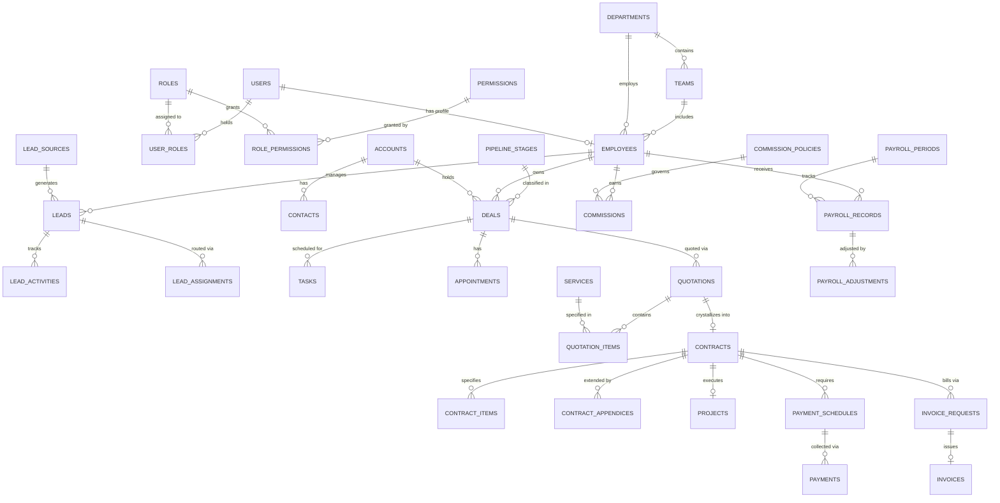

# Enterprise CRM – Database Schema & ERD Proposal

## 1. Overview & Database Standards

The database is built on **Supabase PostgreSQL**. The schema conforms to standard relational database design (3NF), optimized for OLTP workloads and analytics queries.

### Key Rules
- **Primary Keys**: Every entity uses `UUID` (`uuid_generate_v4()`) for non-sequential, globally unique identification.
- **Monetary / Financial Quantities**: Strictly use `DECIMAL(18, 2)` or `NUMERIC(18, 2)`—never floating-point types (`float` / `double`).
- **Audit Columns**: Every table inherits from `BaseEntity`:
  - `id UUID PRIMARY KEY DEFAULT gen_random_uuid()`
  - `created_at TIMESTAMPTZ NOT NULL DEFAULT timezone('utc', now())`
  - `created_by UUID NULL REFERENCES users(id)`
  - `updated_at TIMESTAMPTZ NOT NULL DEFAULT timezone('utc', now())`
  - `updated_by UUID NULL REFERENCES users(id)`
  - `is_deleted BOOLEAN NOT NULL DEFAULT FALSE`
  - `deleted_at TIMESTAMPTZ NULL`
  - `deleted_by UUID NULL REFERENCES users(id)`
- **Soft Deletion**: All business entities utilize soft deletion to guarantee auditability and historical data preservation.
- **Indexing Strategy**: B-tree indexes are placed on foreign keys, tenant/organization identifiers, search columns (email, phone, tax code), status fields, and created_at timestamps. Full-text search (tsvector) is utilized on Lead, Account, and Deal names.

---

## 2. Entity-Relationship Diagram (ERD)

---

## 3. Detailed Entity Definitions by Module

### 3.1 Organization, Identity & RBAC
1. **`users`**:
   - `id` (UUID, PK), `email` (VARCHAR(256), UNIQUE), `password_hash` (VARCHAR(512)), `salt` (VARCHAR(128)), `first_name` (VARCHAR(100)), `last_name` (VARCHAR(100)), `is_active` (BOOLEAN), `last_login_at` (TIMESTAMPTZ), `refresh_token` (TEXT), `refresh_token_expires_at` (TIMESTAMPTZ).
2. **`departments`**:
   - `id` (UUID, PK), `code` (VARCHAR(50), UNIQUE), `name` (VARCHAR(150)), `manager_id` (UUID, FK -> users), `description` (TEXT).
3. **`teams`**:
   - `id` (UUID, PK), `department_id` (UUID, FK -> departments), `name` (VARCHAR(150)), `team_leader_id` (UUID, FK -> users).
4. **`employees`**:
   - `id` (UUID, PK), `user_id` (UUID, FK -> users, UNIQUE), `department_id` (UUID, FK -> departments), `team_id` (UUID, FK -> teams, NULLABLE), `employee_code` (VARCHAR(50), UNIQUE), `position` (VARCHAR(100)), `phone` (VARCHAR(50)), `hire_date` (DATE), `base_salary` (DECIMAL(18,2)), `is_active` (BOOLEAN).
5. **`roles`**:
   - `id` (UUID, PK), `name` (VARCHAR(100), UNIQUE) - `Admin`, `CEO_BOD`, `Manager`, `Sales`, `Accountant`.
   - `description` (VARCHAR(255)), `is_system` (BOOLEAN).
6. **`permissions`**:
   - `id` (UUID, PK), `code` (VARCHAR(100), UNIQUE) e.g., `leads.view_all`, `deals.manage`, `payroll.approve`.
   - `module` (VARCHAR(50)), `description` (VARCHAR(255)).
7. **`user_roles`**:
   - `user_id` (UUID, FK -> users), `role_id` (UUID, FK -> roles), PRIMARY KEY (`user_id`, `role_id`).
8. **`role_permissions`**:
   - `role_id` (UUID, FK -> roles), `permission_id` (UUID, FK -> permissions), PRIMARY KEY (`role_id`, `permission_id`).

### 3.2 Lead Management
9. **`lead_sources`**:
   - `id` (UUID, PK), `name` (VARCHAR(100)), `type` (VARCHAR(50)) - `FacebookAds`, `GoogleAds`, `TikTokAds`, `WebsiteForm`, `ManualEntry`, `ColdCall`.
   - `utm_source` (VARCHAR(100)), `utm_campaign` (VARCHAR(100)), `is_active` (BOOLEAN).
10. **`leads`**:
    - `id` (UUID, PK), `source_id` (UUID, FK -> lead_sources), `assigned_employee_id` (UUID, FK -> employees, NULLABLE),
    - `first_name` (VARCHAR(100)), `last_name` (VARCHAR(100)), `company_name` (VARCHAR(200)), `phone` (VARCHAR(50), INDEX),
    - `email` (VARCHAR(256), INDEX), `job_title` (VARCHAR(100)), `estimated_budget` (DECIMAL(18,2)),
    - `status` (VARCHAR(50)) - `New`, `Contacted`, `Qualified`, `Unqualified`, `Converted`, `Stagnant`,
    - `score` (INTEGER DEFAULT 0), `is_key_account` (BOOLEAN DEFAULT FALSE),
    - `converted_account_id` (UUID, NULLABLE), `converted_contact_id` (UUID, NULLABLE), `converted_deal_id` (UUID, NULLABLE),
    - `converted_at` (TIMESTAMPTZ NULL).
11. **`lead_activities`**:
    - `id` (UUID, PK), `lead_id` (UUID, FK -> leads), `employee_id` (UUID, FK -> employees),
    - `activity_type` (VARCHAR(50)) - `Call`, `Email`, `Meeting`, `Note`, `StatusChange`,
    - `subject` (VARCHAR(200)), `notes` (TEXT), `scheduled_at` (TIMESTAMPTZ), `completed_at` (TIMESTAMPTZ).
12. **`lead_assignments`**:
    - `id` (UUID, PK), `lead_id` (UUID, FK -> leads), `employee_id` (UUID, FK -> employees),
    - `rule_type` (VARCHAR(50)) - `RoundRobin`, `WorkloadBased`, `Manual`,
    - `assigned_at` (TIMESTAMPTZ), `accepted_at` (TIMESTAMPTZ NULL).

### 3.3 Customer & Sales CRM
13. **`accounts`** (Organizations / Businesses):
    - `id` (UUID, PK), `code` (VARCHAR(50), UNIQUE), `name` (VARCHAR(255)), `tax_code` (VARCHAR(50), INDEX),
    - `industry` (VARCHAR(100)), `website` (VARCHAR(255)), `phone` (VARCHAR(50)), `email` (VARCHAR(256)),
    - `billing_address` (TEXT), `classification` (VARCHAR(50)) - `VIP`, `Standard`, `Prospect`, `Partner`,
    - `assigned_employee_id` (UUID, FK -> employees).
14. **`contacts`** (Individual decision-makers):
    - `id` (UUID, PK), `account_id` (UUID, FK -> accounts), `first_name` (VARCHAR(100)), `last_name` (VARCHAR(100)),
    - `email` (VARCHAR(256)), `phone` (VARCHAR(50)), `position` (VARCHAR(100)), `is_primary` (BOOLEAN DEFAULT FALSE).
15. **`pipeline_stages`**:
    - `id` (UUID, PK), `name` (VARCHAR(100)), `order_index` (INTEGER), `probability` (DECIMAL(5,2)),
    - `is_won_stage` (BOOLEAN DEFAULT FALSE), `is_lost_stage` (BOOLEAN DEFAULT FALSE), `color_code` (VARCHAR(20)).
16. **`deals`**:
    - `id` (UUID, PK), `code` (VARCHAR(50), UNIQUE), `title` (VARCHAR(255)), `account_id` (UUID, FK -> accounts),
    - `contact_id` (UUID, FK -> contacts), `stage_id` (UUID, FK -> pipeline_stages), `assigned_employee_id` (UUID, FK -> employees),
    - `amount` (DECIMAL(18,2)), `expected_closing_date` (DATE), `actual_closing_date` (DATE NULL),
    - `status` (VARCHAR(50)) - `Open`, `Won`, `Lost`, `Stagnant`, `lost_reason` (TEXT NULL).
17. **`tasks`**:
    - `id` (UUID, PK), `deal_id` (UUID, FK -> deals, NULLABLE), `account_id` (UUID, FK -> accounts, NULLABLE),
    - `assigned_employee_id` (UUID, FK -> employees), `title` (VARCHAR(200)), `due_date` (TIMESTAMPTZ),
    - `priority` (VARCHAR(20)) - `Low`, `Medium`, `High`, `Urgent`, `status` (VARCHAR(30)) - `Pending`, `InProgress`, `Completed`, `Overdue`.
18. **`appointments`**:
    - `id` (UUID, PK), `deal_id` (UUID, FK -> deals, NULLABLE), `contact_id` (UUID, FK -> contacts),
    - `employee_id` (UUID, FK -> employees), `title` (VARCHAR(200)), `start_time` (TIMESTAMPTZ), `end_time` (TIMESTAMPTZ),
    - `location` (VARCHAR(255)), `meeting_link` (VARCHAR(500)), `status` (VARCHAR(30)).

### 3.4 Quotations & Contracts (CPQ)
19. **`services`**:
    - `id` (UUID, PK), `code` (VARCHAR(50), UNIQUE), `name` (VARCHAR(200)), `category` (VARCHAR(100)),
    - `unit` (VARCHAR(50)), `base_price` (DECIMAL(18,2)), `vat_rate` (DECIMAL(5,2) DEFAULT 8.0), `description` (TEXT), `is_active` (BOOLEAN).
20. **`quotations`**:
    - `id` (UUID, PK), `quotation_number` (VARCHAR(50), UNIQUE), `deal_id` (UUID, FK -> deals),
    - `valid_until` (DATE), `subtotal` (DECIMAL(18,2)), `discount_amount` (DECIMAL(18,2)), `vat_amount` (DECIMAL(18,2)),
    - `total_amount` (DECIMAL(18,2)), `status` (VARCHAR(30)) - `Draft`, `Submitted`, `Approved`, `Rejected`, `Sent`,
    - `approved_by` (UUID, FK -> users, NULLABLE), `approved_at` (TIMESTAMPTZ NULL).
21. **`quotation_items`**:
    - `id` (UUID, PK), `quotation_id` (UUID, FK -> quotations), `service_id` (UUID, FK -> services),
    - `quantity` (DECIMAL(10,2)), `unit_price` (DECIMAL(18,2)), `discount_rate` (DECIMAL(5,2)), `line_total` (DECIMAL(18,2)).
22. **`contracts`**:
    - `id` (UUID, PK), `contract_number` (VARCHAR(50), UNIQUE), `quotation_id` (UUID, FK -> quotations, NULLABLE),
    - `account_id` (UUID, FK -> accounts), `title` (VARCHAR(255)), `start_date` (DATE), `end_date` (DATE),
    - `total_value` (DECIMAL(18,2)), `status` (VARCHAR(30)) - `Draft`, `InReview`, `Approved`, `Signed`, `Active`, `Expired`, `Terminated`,
    - `esign_status` (VARCHAR(30)) - `NotSent`, `PendingSignature`, `Completed`, `Declined`,
    - `document_url` (VARCHAR(500)), `signed_document_url` (VARCHAR(500)).
23. **`contract_items`**:
    - `id` (UUID, PK), `contract_id` (UUID, FK -> contracts), `service_id` (UUID, FK -> services),
    - `quantity` (DECIMAL(10,2)), `unit_price` (DECIMAL(18,2)), `line_total` (DECIMAL(18,2)).
24. **`contract_appendices`**:
    - `id` (UUID, PK), `contract_id` (UUID, FK -> contracts), `appendix_number` (VARCHAR(50)),
    - `title` (VARCHAR(200)), `adjustment_value` (DECIMAL(18,2)), `effective_date` (DATE), `document_url` (VARCHAR(500)).

### 3.5 Projects, Finance & Invoicing
25. **`projects`**:
    - `id` (UUID, PK), `code` (VARCHAR(50), UNIQUE), `contract_id` (UUID, FK -> contracts),
    - `name` (VARCHAR(200)), `manager_id` (UUID, FK -> employees), `start_date` (DATE), `deadline` (DATE),
    - `status` (VARCHAR(30)) - `Planning`, `InProgress`, `OnHold`, `Completed`, `Cancelled`, `progress_percent` (INTEGER).
26. **`payment_schedules`**:
    - `id` (UUID, PK), `contract_id` (UUID, FK -> contracts), `installment_number` (INTEGER),
    - `due_date` (DATE), `amount_due` (DECIMAL(18,2)), `amount_paid` (DECIMAL(18,2) DEFAULT 0),
    - `status` (VARCHAR(30)) - `Pending`, `PartiallyPaid`, `Paid`, `Overdue`.
27. **`payments`**:
    - `id` (UUID, PK), `payment_schedule_id` (UUID, FK -> payment_schedules), `contract_id` (UUID, FK -> contracts),
    - `transaction_reference` (VARCHAR(100), UNIQUE), `amount` (DECIMAL(18,2)), `payment_date` (TIMESTAMPTZ),
    - `payment_method` (VARCHAR(50)) - `BankTransfer`, `CreditCard`, `Cash`, `Cheque`,
    - `is_verified` (BOOLEAN DEFAULT TRUE), `verified_by` (UUID, FK -> users).
28. **`invoice_requests`**:
    - `id` (UUID, PK), `contract_id` (UUID, FK -> contracts), `payment_id` (UUID, FK -> payments, NULLABLE),
    - `requested_by` (UUID, FK -> users), `amount` (DECIMAL(18,2)), `status` (VARCHAR(30)) - `Pending`, `Approved`, `Issued`, `Rejected`.
29. **`invoices`**:
    - `id` (UUID, PK), `invoice_request_id` (UUID, FK -> invoice_requests), `invoice_number` (VARCHAR(50), UNIQUE),
    - `e_invoice_provider` (VARCHAR(50)) - `MISA`, `VNPT`, `Viettel`, `Mock`,
    - `provider_transaction_id` (VARCHAR(100)), `issue_date` (DATE), `tax_rate` (DECIMAL(5,2)), `tax_amount` (DECIMAL(18,2)),
    - `total_with_tax` (DECIMAL(18,2)), `xml_url` (VARCHAR(500)), `pdf_url` (VARCHAR(500)),
    - `status` (VARCHAR(30)) - `Draft`, `Published`, `SentToCustomer`, `Cancelled`.

### 3.6 Sales Performance, Commissions & Payroll
30. **`kpis`**:
    - `id` (UUID, PK), `employee_id` (UUID, FK -> employees), `period_month` (INTEGER), `period_year` (INTEGER),
    - `target_revenue` (DECIMAL(18,2)), `target_deals_won` (INTEGER), `target_new_leads` (INTEGER),
    - `achieved_revenue` (DECIMAL(18,2) DEFAULT 0), `achieved_deals_won` (INTEGER DEFAULT 0).
31. **`commission_policies`**:
    - `id` (UUID, PK), `name` (VARCHAR(150)), `policy_type` (VARCHAR(50)) - `RevenueBased`, `CollectedCashBased`, `ServiceTierBased`, `NewCustomerBonus`,
    - `min_threshold` (DECIMAL(18,2)), `max_threshold` (DECIMAL(18,2) NULL), `rate_percent` (DECIMAL(5,2)),
    - `effective_from` (DATE), `effective_to` (DATE NULL), `is_active` (BOOLEAN).
32. **`commissions`**:
    - `id` (UUID, PK), `employee_id` (UUID, FK -> employees), `deal_id` (UUID, FK -> deals), `contract_id` (UUID, FK -> contracts),
    - `policy_id` (UUID, FK -> commission_policies), `calculated_amount` (DECIMAL(18,2)),
    - `status` (VARCHAR(30)) - `Calculated`, `Approved`, `Paid`, `Cancelled`,
    - `payroll_record_id` (UUID, NULLABLE).
33. **`payroll_periods`**:
    - `id` (UUID, PK), `name` (VARCHAR(100)), `month` (INTEGER), `year` (INTEGER),
    - `start_date` (DATE), `end_date` (DATE), `status` (VARCHAR(30)) - `Draft`, `Processing`, `Locked`, `Paid`.
34. **`payroll_records`**:
    - `id` (UUID, PK), `payroll_period_id` (UUID, FK -> payroll_periods), `employee_id` (UUID, FK -> employees),
    - `base_salary` (DECIMAL(18,2)), `total_commission` (DECIMAL(18,2)), `bonuses` (DECIMAL(18,2)),
    - `deductions` (DECIMAL(18,2)), `net_salary` (DECIMAL(18,2)),
    - `status` (VARCHAR(30)) - `PendingReview`, `ApprovedByManager`, `ApprovedByDirector`, `Disbursed`.
35. **`payroll_adjustments`**:
    - `id` (UUID, PK), `payroll_record_id` (UUID, FK -> payroll_records), `type` (VARCHAR(30)) - `Bonus`, `Penalty`, `Advance`, `TaxAdjustment`,
    - `amount` (DECIMAL(18,2)), `reason` (TEXT), `approved_by` (UUID, FK -> users).

### 3.7 Automation, AI & System Governance
36. **`workflow_definitions`**:
    - `id` (UUID, PK), `name` (VARCHAR(150)), `trigger_event` (VARCHAR(100)), `conditions_json` (JSONB),
    - `actions_json` (JSONB), `is_active` (BOOLEAN).
37. **`workflow_executions`**:
    - `id` (UUID, PK), `workflow_id` (UUID, FK -> workflow_definitions), `entity_type` (VARCHAR(50)),
    - `entity_id` (UUID), `status` (VARCHAR(30)), `executed_at` (TIMESTAMPTZ), `result_summary` (TEXT).
38. **`notifications`**:
    - `id` (UUID, PK), `recipient_user_id` (UUID, FK -> users), `title` (VARCHAR(200)),
    - `message` (TEXT), `link` (VARCHAR(255)), `is_read` (BOOLEAN DEFAULT FALSE), `type` (VARCHAR(50)).
39. **`audit_logs`**:
    - `id` (UUID, PK), `user_id` (UUID, FK -> users, NULLABLE), `action` (VARCHAR(50)), `entity_name` (VARCHAR(100)),
    - `entity_id` (VARCHAR(100)), `ip_address` (VARCHAR(50)), `old_values` (JSONB NULL), `new_values` (JSONB NULL),
    - `timestamp` (TIMESTAMPTZ DEFAULT timezone('utc', now())).
40. **`ai_conversations`** & **`ai_messages`**:
    - Chat history and context tokens for AI Assistant interactions bound to the authenticated user.
41. **`integration_configurations`** & **`webhook_events`**:
    - Webhook deduplication log (`idempotency_key`, `payload_hash`, `processed_at`, `status`).

---

## 4. Database Security & Concurrency Controls
- **Transactions**: Multi-step operations (e.g. Lead conversion into Account + Contact + Deal, Contract creation + Payment Schedule generation, Payment recording + Schedule update) are executed inside serializable/read-committed explicit EF Core transactions (`IDbContextTransaction`).
- **Optimistic Concurrency**: Row version / concurrency tokens (`xmin` in PostgreSQL) on sensitive records like Deals, Payments, and Payroll records.
